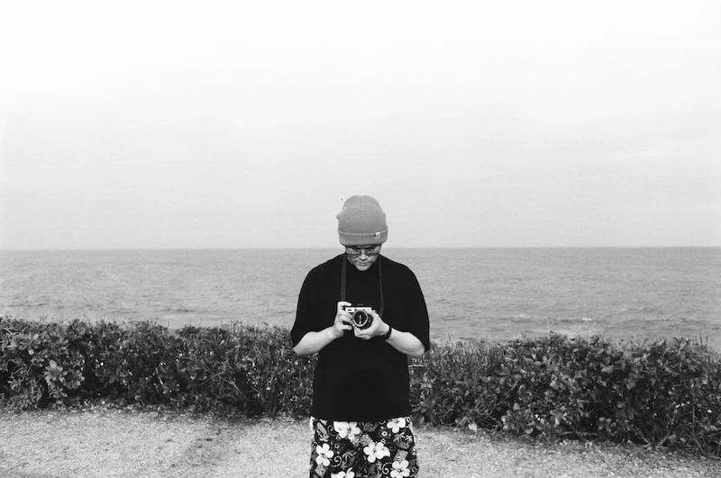

import { Black } from '/src/components/Chess/ChessGame';
import Marquee from "react-fast-marquee";
import ContributionCalendar from '@site/src/components/ContributionCalendar/ContributionCalendar';
import SiteStats from '@site/src/components/SiteStats';
import Link from '@docusaurus/Link';

  <h1 className="site-hero-title">About</h1>

  
  

    
黃碩人，出生於西元 1998 年。

	
現居臺北，土木工程師，女朋友綽號是蝦波。

    
歡迎到<Link to="/guestbook">留言板</Link>逛逛，有任何想說的，也可以聯絡我的信箱。

    
me@shuojen.com

  

這裡是我記錄生活和興趣的地方，我支持開放自由的數位世界，大家應該享受沒有<strong>商業廣告</strong>、沒有<strong>演算法</strong>、沒有<strong>登入限制</strong>的社群自由，而不是限縮在大公司的框架下，等著它們隨時對你予取予求。

不知道該怎麼開始嗎？請看<a href="https://blogblog.club/resources/">這裡</a>架設一個屬於自己的網站吧。

  <Marquee gradient={false} speed={50}>
    我直接放一盤 <a href="https://www.youtube.com/watch?v=oH-txHzE4jA">Bill Gates vs Magnus Carlsen</a> 九步就被將殺的對局，沒有為什麼，因為個人網頁很<strong><em>自由</em></strong>！
  </Marquee>

<Black pgn="1. e4 Nc6 2. Nf3 d5 3. Bd3 Nf6 4. exd5 Qxd5 5. Nc3 Qh5 6. O-O Bg4 7. h3 Ne5 8. hxg4 Nfxg4 9. Nxe5 Qh2#" />

<h2 className="abC-title">主要內容</h2>

  <Link to="/docs/intro" className="abC-tile"><small>01</small><strong>興趣分享</strong>常駐的興趣分享區塊，包含西洋棋、魔術方塊等。</Link>
  <Link to="/blog" className="abC-tile"><small>02</small><strong>貼文紀錄</strong>部落格式的不定時紀錄， 2025 以前的內容是從社群媒體搬運過來的。</Link>
  <Link to="/photography" className="abC-tile"><small>03</small><strong>攝影作品</strong>偶爾出遊時心血來潮拍攝的作品紀錄，2019 年從底片相機開始入攝影坑。</Link>

<h2 className="abC-title">其他頁面</h2>

  

    <h3>關於</h3>
    <ul className="abC-index">
      <li><Link to="/use">我在用什麼<code>/use</code></Link></li>
      <li><Link to="/now">我在做什麼<code>/now</code></Link></li>
      <li><Link to="/tool">小工具<code>/tool</code></Link></li>
    </ul>
  

  

    <h3>瀏覽</h3>
    <ul className="abC-index">
      <li><Link to="/blog/archive">貼文列表<code>/blog/archive</code></Link></li>
      <li><Link to="/photoblog/photo-archive">攝影列表<code>/photoblog/photo-archive</code></Link></li>
      <li><Link to="/albums">專輯牆<code>/albums</code></Link></li>
      <li><Link to="/random">隨機貼文<code>/random</code></Link></li>
      <li><Link to="/search">站內搜尋<code>/search</code></Link></li>
    </ul>
  

  

    <h3>排名</h3>
    <ul className="abC-index">
      <li><Link to="/docs/movie_list">電影清單<code>/docs/movie_list</code></Link></li>
      <li><Link to="/docs/anime">動漫清單<code>/docs/anime</code></Link></li>
      <li><Link to="/docs/series">劇集清單<code>/docs/series</code></Link></li>
      <li><Link to="/docs/ramen">拉麵清單<code>/docs/ramen</code></Link></li>
      <li><Link to="/docs/jinyung">金庸清單<code>/docs/jinyung</code></Link></li>
    </ul>
  

  

    <h3>交流</h3>
    <ul className="abC-index">
      <li><Link to="/blogroll">部落卷<code>/blogroll</code></Link></li>
      <li><Link to="/guestbook">留言板<code>/guestbook</code></Link></li>
    </ul>
  

歡迎在下方使用 RSS 連結訂閱我的文章（ <Link to="/blog/2025/09/16/rss#%E8%AA%8D%E8%AD%98-rss">那是什麼？</Link>）

  
Blog 貼文 RSS<code>https://shuojen.com/blog/rss.xml</code>

  
攝影貼文 RSS<code>https://shuojen.com/photoblog/rss.xml</code>

<h2 className="abC-title">即時數據</h2>
<SiteStats />
<ContributionCalendar />

